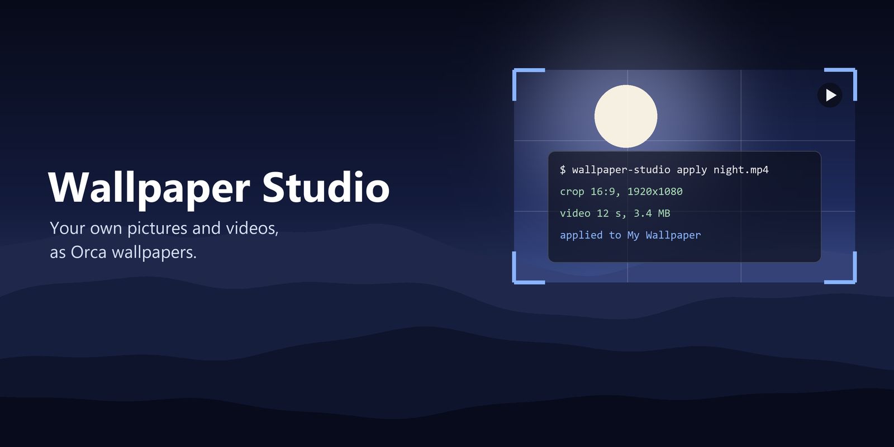

<p align="center">
  
</p>

# Wallpaper Studio

Use your own picture or video as the wallpaper of Orca. Open a file, crop and adjust it in a small editor, and Wallpaper Studio turns it into the background of a **My Wallpaper** theme and keeps that theme up to date for you.

- **Pictures and videos.** JPG, PNG, WebP, BMP and GIF, or MP4, MOV, WebM, MKV and AVI video, up to 50 MB.
- **Video wallpapers** (Orca 1.4.254 or newer). Pick the part to use with a start and end handle, preview it in a loop, change its speed, and Studio encodes an H.264 MP4 of at most 8 MB with a still first frame as the fallback.
- **A real editor.** Crop frame with screen, 16:9, 16:10, 21:9, 4:3, 1:1 and portrait ratios (3:4, 10:16, 9:16) or the whole image, rotate and flip, brightness, darken and blur, and a live preview under Orca's translucent terminal.
- **Three wallpaper slots.** **My Wallpaper**, **My Wallpaper 2** and **My Wallpaper 3**, each with a dark-sidebar and a light-sidebar variant.
- **Edit again later.** Every slot remembers its original picture and all your settings. Reopen the panel and the editor comes back as you left it, ready to adjust and apply again.
- **Your language.** The panel follows Orca's language (Vietnamese or English).
- **One plugin.** The My Wallpaper themes are part of Wallpaper Studio itself.

## Requirements

- Orca **1.4.246 or newer** (**1.4.254** for video wallpapers).
- **Python 3 with [Pillow](https://pypi.org/project/Pillow/)**: `pip install Pillow`. The plugin finds Python by itself (`py -3`, `python3`, `python` and the usual per-user install folders). Set **Python with Pillow** in the plugin's settings only if it cannot.
- **ffmpeg with libx264, for video only**: `pip install imageio-ffmpeg` (it brings its own ffmpeg), or put `ffmpeg` on your `PATH`, or set the `WALLPAPER_FFMPEG` environment variable to the executable. Pictures work without it.

## Install

1. **Get the plugin into Orca.** The simplest way is **Settings → Plugins → Install plugin → Git URL** with `https://github.com/dohaidang/orca-wallpaper-studio`. To keep everything in this single plugin, clone the repository and load the clone as a development folder instead (**Settings → Plugins → Development folders**, or `orca plugin dev load <clone folder>`); see the note below.
2. Wallpaper Studio runs its own code in a separate process with your user account's access, so Orca asks you to approve it before it starts. Read what it lists and approve it if you trust it.
3. Open the **Wallpaper Studio** panel from the right sidebar (the layers icon).
4. Check the **Quick Setup Note** below once. Without it Orca hides the wallpaper, even though Apply succeeded.

> [!IMPORTANT]
> **Quick Setup Note.** A wallpaper only shows, and a video only plays, when these Orca and Windows settings allow it. They are Orca's own settings, not the plugin's, so you set them once:
>
> | Setting | Value | Where |
> | --- | --- | --- |
> | **Background Opacity** | below **1** (try `0.6`) | Settings → Appearance → Interface → Advanced, and Terminal → Advanced |
> | **Reduce Visual Effects** | **off** | Settings → Appearance |
> | **Transparency effects** (Windows) | **on** | Windows Settings → Personalization → Colors |
> | **Theme** | the **My Wallpaper** theme of the slot you applied | Settings → Appearance |
>
> With Background Opacity at 1 the terminal covers the picture completely. A video also needs Orca 1.4.254 or newer and plays while the Orca window has focus.
>
> The **Wallpaper strength** slider in the panel is a different setting: it is saved in the theme itself (how strong the picture is), while Background Opacity above is Orca's own.

## Use it

1. Press **Choose image…** and pick a picture or a video.
2. Drag the crop frame and scroll to zoom. Choose the ratio, rotate or flip if needed.
3. For a video, press **Preview** to watch it, drag the two handles under **Part to use** to trim it, and use **Set as start / Set as end** at the frame you are looking at.
4. Under **Apply to**, choose slot 1, 2 or 3 and a mode:
   - **Stock Orca** (default): a still image of at most 2 MB, accepted by any Orca.
   - **Video**: an MP4 wallpaper (Orca 1.4.254+). A video file always uses this mode.
   - **Patched Orca**: animated WebP up to 16 MB, only for an Orca you modified to accept it.
5. Press **Apply to Orca**. The result stays in the panel, and the panel reopens with the same picture and settings.
6. Under **Settings → Appearance**, select the **My Wallpaper** theme for that slot. Make sure the settings in the **Quick Setup Note** above are in place, so Orca paints the wallpaper behind the terminal.

**One plugin, or one extra folder.** Orca reads a theme's wallpaper only from inside the plugin that contributes the theme, and a plugin installed from the catalog or a Git URL sits in a read-only folder. Loaded as a development folder, Studio writes your picture straight into its own folder. Installed from a Git URL, it cannot, so the first time you press Apply it creates a small theme plugin named **Orca My Wallpaper** in your home folder and loads it into Orca for you (Orca shows it as "Dev · unverified", because the pictures are yours); after that it only rewrites the picture. Choose that folder with the **My Wallpaper themes folder** setting. In that case you will see two sets of My Wallpaper themes; use the one from the extra folder.

Your original pictures, previews and settings are kept in `%APPDATA%\orca-wallpaper-studio\library` (set `WALLPAPER_STUDIO_LIBRARY` to move it), so a slot can be reopened later and updating the plugin never loses them. Nothing you open leaves your computer.

## Limits

| | Still image | Video |
| --- | --- | --- |
| Format written | WebP | H.264 MP4, no audio, 20 fps |
| Size | up to 2 MB (Stock) or 16 MB (Patched) | up to 8 MB |
| Length | | up to 60 seconds |
| Picture size | 640×360 to 4096×4096 | at least 640×360, at most 2,304,000 pixels |

Studio lowers quality and then size until the result fits, and tells you what it changed. A video also keeps a still copy of its first frame as the theme's fallback picture, for an Orca that cannot play video. Applying a still image to a slot removes that slot's old video, so it cannot keep playing over the new picture.

## How it works

An Orca panel cannot write files, and one panel message carries at most 64 KiB. So the panel sends the chosen file to the plugin's worker in chunks, and the worker runs `tools/wallpaper_cli.py`. That uses Pillow (and ffmpeg for video) to crop, adjust and encode the file, writes it into the My Wallpaper theme folder, updates the slot's theme files and reloads that folder in Orca.

Orca restarts a development plugin's worker (and may reload its panel) whenever a file in the plugin folder changes, and Studio changes files there when it saves your picture. So the encode does not depend on the worker: it runs as a separate process that reports its progress and result in a small job file under `%APPDATA%\orca-wallpaper-studio\jobs`. The worker and the panel read that file, including after a restart, and the panel then reopens the slot from the saved library.

## Desktop tool

The same editor for still images and GIFs, in a small Tk window:

```sh
python -I tools\wallpaper_studio.py
```

`tools\Mo-trinh-chinh-anh.bat` starts it and `tools\Doi-hinh-nen.bat` sets a wallpaper from a dragged image. They use the same **Orca My Wallpaper** folder; set `WALLPAPER_THEMES_DIR` to use another one.

## Languages

The panel follows Orca's UI language. Vietnamese and English are provided and any other language shows English. Texts are in `panel/i18n.js`; the Python tool's messages are in `tools/wallpaper_core.py` (`_MESSAGES`). To add a language, add a table to each.

## Develop

```sh
orca plugin validate .
orca plugin dev watch .      # loads this folder into Orca and prints its logs
python -I tools/test_wallpaper.py
```

The video tests need ffmpeg and skip themselves without it. `assets/` holds the avatar and the cover used on this page.

## License

[MIT](LICENSE)
